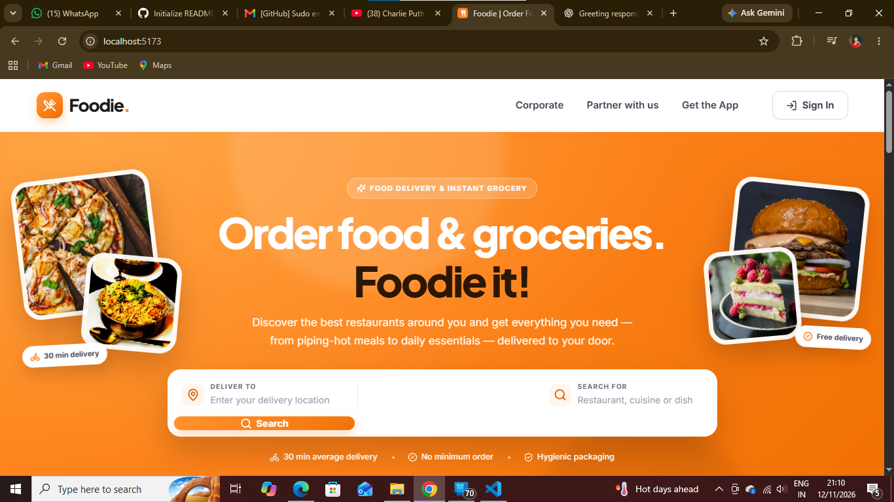
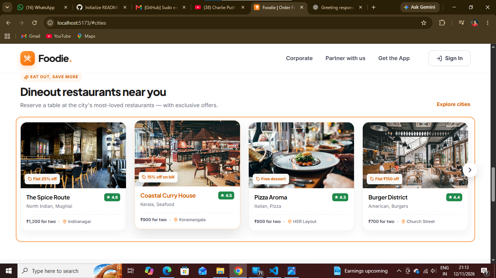
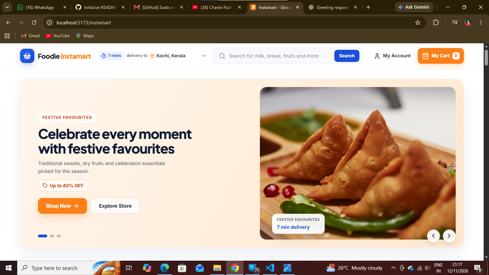

# 🍔 Swiggy — Food & Grocery Delivery Platform

A modern, responsive food delivery and grocery shopping web application inspired by the Swiggy experience. Built with React and Vite, the project combines restaurant discovery, food categories, dining options, and an Instamart-style grocery experience in a single platform.

## 🚀 Live Demo

**Live Demo:** Add your deployed URL here

## 📸 Screenshots

### 🏠 Home Page



### 🍽️ Restaurants



### 🛒 Instamart



> Screenshots are included to show the main user experience and key sections of the application.

## ✨ Features

### 🍴 Food Delivery

- Browse food categories
- Explore restaurants
- View restaurant details
- Browse popular restaurants and food chains
- Restaurant filtering
- Responsive restaurant listing

### 🛍️ Instamart / Grocery

- Grocery category browsing
- Product catalog
- Product cards
- Quantity controls
- Shopping cart drawer
- Account drawer
- Grocery-focused navigation
- Promotional sections

### 🎨 User Interface

- Responsive design
- Modern food-delivery UI
- Reusable React components
- Scrollable category sections
- Navigation and footer
- Authentication modal UI
- Clean component-based architecture

## 🛠️ Tech Stack

| Technology | Usage |
|---|---|
| React.js | Frontend development |
| Vite | Development and build tool |
| JavaScript | Application logic |
| HTML5 | Structure |
| CSS3 | Styling and responsive UI |
| Git | Version control |
| GitHub | Source code hosting |

## 📁 Project Structure

```text
Swiggy-App/
├── public/
│   └── images/
├── src/
│   ├── components/
│   │   ├── instamart/
│   │   ├── layout/
│   │   ├── restaurants/
│   │   ├── sections/
│   │   └── ui/
│   ├── data/
│   ├── pages/
│   ├── styles/
│   ├── App.jsx
│   └── main.jsx
├── scripts/
├── index.html
├── package.json
├── vite.config.js
└── README.md
```

## ⚙️ Getting Started

### 1. Clone the repository

```bash
git clone https://github.com/vi-pincode123/Swiggy-App.git
```

### 2. Navigate to the project

```bash
cd Swiggy-App
```

### 3. Install dependencies

```bash
npm install
```

### 4. Start the development server

```bash
npm run dev
```

The application will be available at the local URL shown in the terminal.

## 🧩 Project Architecture

The application is organized into reusable React components and page-level sections.

- **Components** — reusable UI elements and feature-specific components
- **Pages** — main application screens
- **Data** — restaurant, grocery, and home-page data
- **Styles** — global and component-specific CSS
- **Public** — static images and assets
- **Scripts** — utility scripts used by the project

This structure makes the application easier to maintain and extend as new features are added.

## 🎯 What I Built

The main goal of this project was to build a realistic food and grocery delivery experience rather than a simple static landing page.

I focused on:

- Breaking the UI into reusable React components
- Building separate experiences for restaurants and grocery shopping
- Creating responsive layouts
- Managing reusable product and restaurant data
- Building interactive UI elements such as drawers, quantity controls, filters, and modals
- Organizing the project using a scalable component structure

## 🔮 Future Improvements

With more development time, the application could be extended with:

- User authentication
- Backend API integration
- Real-time restaurant and product data
- Location-based restaurant discovery
- Order placement and order tracking
- Online payment integration
- Persistent shopping cart
- User profiles and order history
- Restaurant and product search
- Production deployment

## 📌 Note

This project is an independent Swiggy-inspired implementation created for learning and portfolio purposes. It is not affiliated with or endorsed by Swiggy.

## 👨‍💻 Author

**Vipin Raj**

GitHub:  
https://github.com/vi-pincode123

---

⭐ If you find this project interesting, feel free to explore the code and share feedback.
